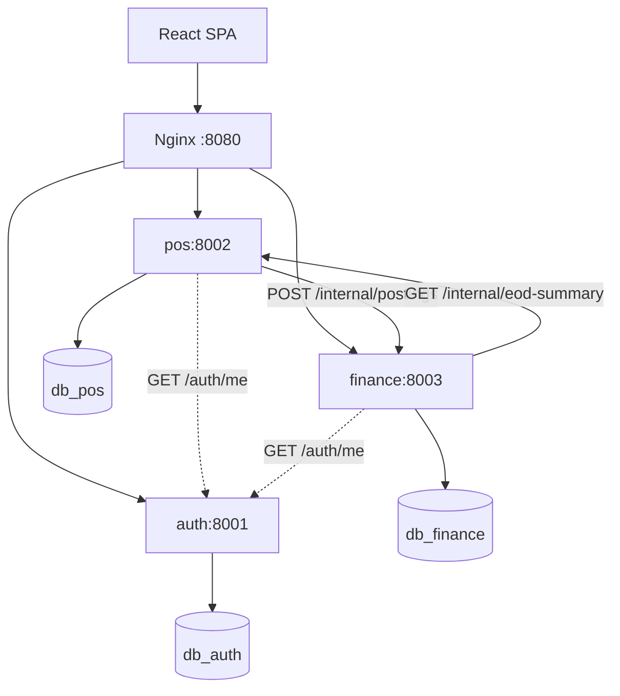
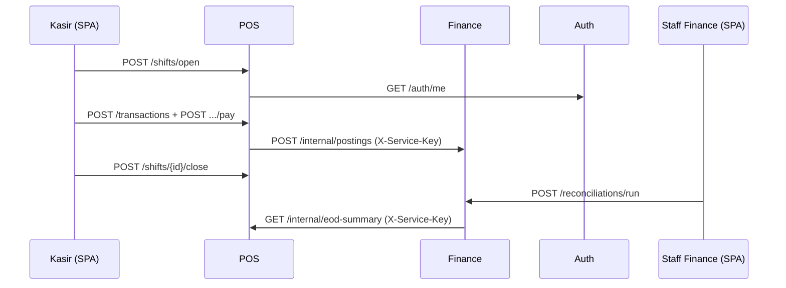

# POS + Finance System

## Ringkasan sistem

- **Auth Service** (Laravel 12, `:8001`, `db_auth`)
- **POS Service** (Laravel 12, `:8002`, `db_pos`)
- **Finance Service** (Laravel 12, `:8003`, `db_finance`)
- **Frontend**: React + TypeScript + Vite, shadcn/ui, Zustand, TanStack Query,
  React Hook Form + Zod, React Router.
- **Gateway**: Nginx `:8080` (`/api/auth/*`, `/api/pos/*`, `/api/finance/*`
- **Database**: 3 MySQL

## Stack teknologi

| Layer | Teknologi |
|---|---|
| Backend Services | Laravel (PHP) 12 — Auth `:8001`, POS `:8002`, Finance `:8003` |
| Frontend | React.js + TypeScript + Vite (satu SPA), shadcn/ui, Zustand, TanStack Query, React Hook Form + Zod, React Router |
| Database | MySQL 8 — `db_auth`, `db_pos`, `db_finance` (terisolasi, `:33061–33063`) |
| API Style | REST (`/api/auth/*`, `/api/pos/*`, `/api/finance/*` via gateway) |
| Containerization | Docker + Docker Compose |
| Auth | JWT terpusat di Auth Service, dikonsumsi POS + Finance via `GET /auth/me` |
| API Gateway | Nginx reverse proxy `:8080` (`/internal/*` selalu 404) |

## Diagram arsitektur dan komunikasi





## Flow transaksi end-to-end

| # | Langkah | Aktor | Endpoint | Hasil |
|---|---|---|---|---|
| 1 | Buka shift | kasir | `POST /shifts/open` (`opening_cash`) | Shift `open`; satu kasir max satu shift open; outlet dari JWT |
| 2 | Buat transaksi | kasir | `POST /transactions` (items + `discount_amount` opsional) | Status `pending`; harga/`unit_price` dari server, PPN 11% dihitung server |
| 3 | Bayar | kasir | `POST /transactions/{id}/pay` (`payment_method`, `paid_amount`) | `paid`; tunai: `paid ≥ grand` + kembalian; debit/qris: `paid == grand`; lalu posting ke Finance |
| 4 | Posting jurnal | POS → Finance | `POST /internal/postings` (service key) | Jurnal seimbang; `synced`, atau `failed` + `finance_last_error` (pay tetap sukses) |
| 4b | Void (cabang) | supervisor_pos | `POST /transactions/{id}/void` (`reason` wajib) | `void`; reversal ke Finance; hanya jika shift masih `open` |
| 5 | Tutup shift | kasir | `POST /shifts/{id}/close` (`actual_cash`) | `closed`; `expected_cash` + `cash_variance`; tolak 409 bila ada `pending`; `unsynced_count` sebagai peringatan |
| 6 | Rekonsiliasi EOD | staff_finance | `POST /reconciliations/run` (`outlet_id`, `business_date`) | `matched` atau `mismatch` (`AMOUNT_DIFF`/`COUNT_DIFF`/`CASH_VARIANCE`); rerun menimpa baris yang sama |
| 6b | Resolve (cabang) | manager_finance | `PATCH /reconciliations/{id}/resolve` (`resolution_note` wajib) | `resolved`, final (run ulang → 409) |

## Struktur folder

```
services/auth|pos|finance  # Laravel: app/{Http/{Controllers,Requests,Middleware,Resources},Models,Services,Support}, database, routes, tests
frontend/src               # api, components/{ui,common,layout}, features/{auth,pos,finance,users,dashboard}, lib, routes, store, types
gateway/                   # nginx.conf + Dockerfile
scripts/                   # e2e.sh, health-check.sh
docker-compose.yml         # 3 service + 3 mysql + redis + frontend + gateway
```

## Skema database

- `db_auth` (`services/auth/database/`)
- `db_pos` (`services/pos/database/`)
- `db_finance` (`services/finance/database/`)

## Cara setup dan menjalankan

```bash
cp .env.example .env
docker compose up --build -d
curl localhost:8080/api/auth/health
./scripts/health-check.sh
```

Buka `http://localhost:8080/` untuk frontend.

## Perintah Docker yang sering dipakai

```bash
docker compose up --build -d   # build + jalan pertama kali
docker compose up -d            # jalan ulang (tanpa build)
docker compose ps               # status container
docker compose logs -f          # log semua service (tambah nama service untuk satu saja)
docker compose logs -f pos finance gateway  # contoh: log service tertentu
docker compose down             # hentikan + hapus container (data DB aman di volume)
docker compose down -v          # hentikan + HAPUS volume DB (reset total, seed ulang)
docker compose up --build -d pos        # rebuild satu service saja
docker compose exec mysql-pos mysql -uroot -proot -e "SHOW DATABASES;"  # cek DB
docker compose restart gateway  # restart gateway (mis. setelah ubah nginx.conf)
```

## Daftar URL/port

| Akses | URL |
|---|---|
| Frontend | `http://localhost:8080/` |
| API | `localhost:8080/api/auth/*`, `/api/pos/*`, `/api/finance/*` |
| Langsung (dev/`/internal`) | auth `:8001`, pos `:8002`, finance `:8003` |
| MySQL | `:33061` (auth), `:33062` (pos), `:33063` (finance), user/password `root`/`root` |

## Akun demo (password semua: `Password123!`)

| Email | Role | Outlet |
|---|---|---|
| superadmin@demo.test | superadmin | - |
| kasir.bdg@demo.test | kasir | 1 (BDG) |
| kasir.grt@demo.test | kasir | 2 (GRT) |
| supervisor.bdg@demo.test | supervisor_pos | 1 (BDG) |
| staff.finance@demo.test | staff_finance | - |
| manager.finance@demo.test | manager_finance | - |

## Matriks hak akses

| Aksi | kasir | supervisor_pos | staff_finance | manager_finance | superadmin |
|---|---|---|---|---|---|
| Buka/tutup shift, buat + bayar transaksi | Ya | - | - | - | Ya |
| Lihat transaksi | Milik sendiri | Outlet sendiri | - | - | Semua |
| Void transaksi | - | Ya | - | - | Ya |
| CRUD produk | - | Ya | - | - | Ya |
| Lihat posting + jurnal | - | - | Ya | Ya | Ya |
| Jalankan rekonsiliasi | - | - | Ya | Ya | Ya |
| Resolve mismatch | - | - | - | Ya | Ya |
| Manajemen user | - | - | - | - | Ya |

## Modul frontend

1. **Dashboard** — kasir/supervisor: penjualan + jumlah transaksi hari ini,
   breakdown tunai/debit/QRIS, jumlah belum synced; finance: rekonsiliasi 7 hari
   terakhir + penjualan ledger hari ini.
2. **Layar Kasir** (`/kasir`) — buka shift; produk + pencarian; keranjang
   (qty/hapus), diskon, subtotal/PPN/total; bayar tunai (kembalian) / debit / qris;
   transaksi shift berjalan; tutup shift (expected + selisih pra-konfirmasi).
3. **Riwayat Transaksi** (`/transaksi[/:id]`) — filter status/metode/sync/tanggal +
   paginasi + detail; Void (supervisor, alasan wajib); Resync (hanya bila
   `failed`/`pending`).
4. **Produk** (`/produk`) — search, filter aktif, paginasi; tambah/ubah/nonaktifkan.
5. **Posting & Jurnal** (`/posting[/:id]`) — filter + detail `journal_lines` +
   badge Seimbang/Tidak.
6. **Rekonsiliasi EOD** (`/rekonsiliasi[/:id]`) — outlet+tanggal + Jalankan
   (Ulang); tabel POS vs Finance, selisih **merah** bila ≠ 0; `cash_variance` +
   `mismatch_reasons`; Resolve modal (catatan wajib); badge
   `pending` abu / `matched` hijau / `mismatch` merah / `resolved` biru.
7. **User** (`/users`, superadmin) — CRUD role + `outlet_id`, aktif/nonaktif.


## Endpoint ringkas

- Auth: `POST /auth/login|refresh|logout`, `GET /auth/me`, CRUD `/auth/users` (superadmin).
- POS: `GET /outlets`, CRUD `/products`, `/shifts/open|current|{id}/summary|{id}/close`,
  `/transactions[/{id}|/{id}/pay|/{id}/void|/{id}/resync-finance]`,
  `GET /transactions/{id}/receipt.pdf`, `GET /internal/eod-summary` (service key).
- Finance: `POST /internal/postings` (service key),
  `GET /postings[/{id}]`, `GET /reports/daily-sales`,
  `/reconciliations/run|[/{id}|/{id}/resolve]`, `GET /reconciliations/overview`.